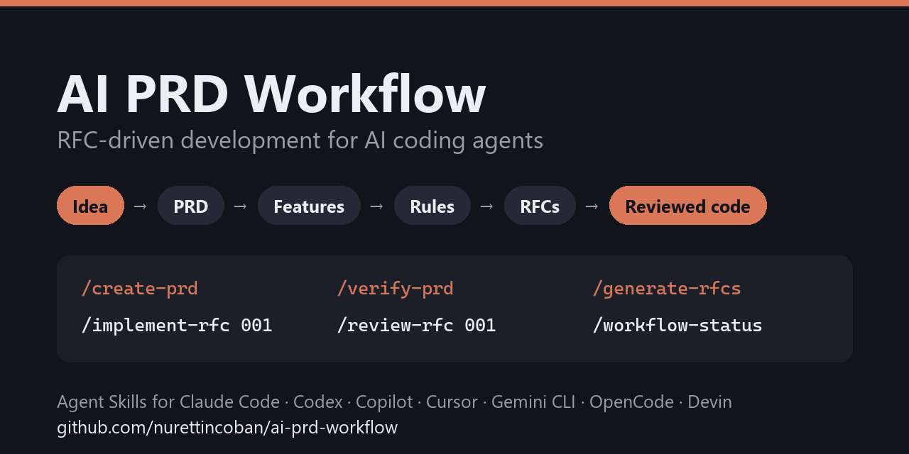
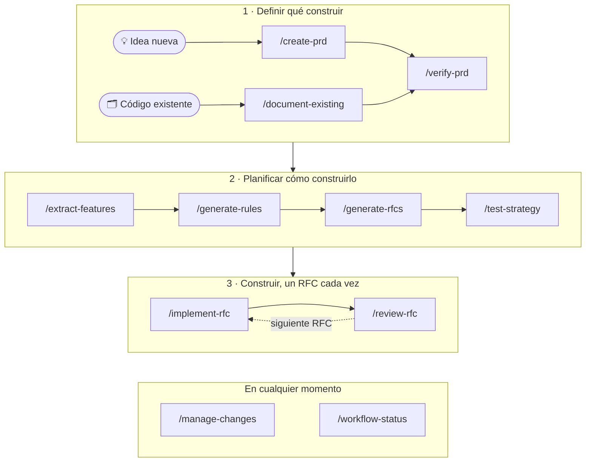

<div align="center">

<a href="https://nurettincoban.github.io/ai-prd-workflow/"></a>

# 📋 AI PRD Workflow

**Idea o código existente → PRD verificado → funcionalidades → reglas → RFC ordenados → código revisado y probado**

[](https://github.com/nurettincoban/ai-prd-workflow/actions/workflows/ci.yml)
[](LICENSE)
[](https://github.com/nurettincoban/ai-prd-workflow/stargazers)
[](#inicio-rápido)
[](#opciones-de-instalación)

**[🌐 Sitio web](https://nurettincoban.github.io/ai-prd-workflow/)** · **[Ver una ejecución real](#lo-que-produjo-una-ejecución)** · **[Inicio rápido](#inicio-rápido)** · **[Cómo funciona](#cómo-funciona)** · **[Por qué](#por-qué-este-flujo-de-trabajo)** · **[Evidencia](#evidencia)** · **[Opciones de instalación](#opciones-de-instalación)**

[English](README.md) · [简体中文](README.zh-CN.md) · [Türkçe](README.tr.md) · [日本語](README.ja.md) · [한국어](README.ko.md) · Español

</div>

> [!NOTE]
> Esta traducción puede ir por detrás del README en inglés; si difieren, manda la [versión en inglés](README.md).

---

Los agentes de programación con IA escriben buen código. Se les da peor decidir qué construir, recordar las decisiones de ayer y darse cuenta de que dos documentos se contradicen. Este flujo de trabajo se encarga de esa parte: lleva una idea —o una base de código que ya existe— a una especificación de producto (PRD) revisada, funcionalidades priorizadas, reglas del proyecto y pequeñas especificaciones de implementación (RFC) en orden de dependencias. Después los implementa y los revisa uno a uno.

Cada paso escribe un archivo markdown que lee el siguiente, así que las decisiones sobreviven a la sesión de chat. Un script comprueba que los archivos siguen siendo coherentes entre sí. Sin CLI que aprender, sin framework que adoptar, sin dependencia de ninguna herramienta: los comandos son prompts normales, instalados como skills para Claude Code, Codex, Copilot, Cursor, Gemini CLI, OpenCode y Devin.

## Lo que produjo una ejecución

Tomamos la especificación de un pequeño acortador de URL que habían producido nuestros propios prompts de la v2.0. Parece terminada. Ejecutamos sobre ella los comandos actuales, y tres de las cosas que detectaron antes de que existiera código fueron:

| Lo que había | Lo que hizo el flujo de trabajo |
|---|---|
| «Redirigir la URL corta a la URL original mediante HTTP 301» | `/verify-prd`: los navegadores guardan en caché un 301, así que los clics repetidos nunca se cuentan y los enlaces borrados siguen redirigiendo. La especificación corregida redirige con 302, y [RFC-003](examples/url-shortener/after/RFCs/RFC-003-Redirect-and-Click-Recording.md) prueba «nunca 301». |
| Sin cuentas de usuario, y cualquiera puede «borrar una URL corta» | `/verify-prd`: cualquiera puede borrar el enlace de cualquiera. No había nadie para decidir, así que escribió la solución que proponía como una pregunta abierta marcada **(assumption)** (supuesto), no como una decisión. |
| [RFC-002](examples/url-shortener/before/RFCs/RFC-002-Click-Analytics.md) afirma cubrir las funcionalidades F5, F6 y F11 | `/workflow-status`: sus criterios de aceptación solo prueban la API, así que nada obligaba a nadie a construir la página de analítica y el gráfico que esas funcionalidades exigen. Todos los ID estaban citados, así que un script no podía verlo. |

**10 de 10** problemas que habíamos listado a mano, encontrados por `/verify-prd` sin ver la lista. **11 de 13** problemas entre documentos, encontrados por `/workflow-status` en cada una de tres ejecuciones, calificadas a ciegas ([el prompt de la 3.1.0 encontró 8, 9 y 8](examples/url-shortener/workflow-status-reruns/GRADING.md), y por eso cambió). **12 RFC** y **203 pruebas planificadas** generados, y cada RFC leído en frío por un segundo modelo, con los lectores lanzados a mano. Alrededor de una hora de tiempo de agente con Claude Opus 5.5, y nadie respondió a las preguntas de los comandos. **[Explora la ejecución completa →](examples/url-shortener/)**

## Inicio rápido

En Claude Code, instala el plugin:

```
/plugin marketplace add nurettincoban/ai-prd-workflow
/plugin install prd-workflow@ai-prd-workflow
```

> [!IMPORTANT]
> Reinicia Claude Code ahora. Una sesión que ya está en marcha no ve las skills nuevas, así que el primer comando falla con `Unknown skill`: parece una instalación rota, pero solo es una sesión antigua.

Después, empieza la entrevista. Dura unos diez minutos, y en unos pocos más `/verify-prd` te dirá si esto es para ti:

```
/prd-workflow:create-prd
/prd-workflow:verify-prd
```

<details>
<summary><b>Codex, GitHub Copilot, Cursor, Gemini CLI, OpenCode, Devin o cualquier asistente de chat</b></summary>

Instala las skills en tu proyecto:

```bash
cd your-project
curl -fsSL https://raw.githubusercontent.com/nurettincoban/ai-prd-workflow/main/install.sh | bash -s -- .
```

Reinicia tu herramienta después de instalar, por la misma razón. En Codex, escribe `$create-prd` en lugar de `/create-prd`. En un asistente de chat (ChatGPT, Claude.ai, …), copia un prompt de la [tabla de comandos](#cómo-funciona) y pégalo.

</details>

La secuencia completa, con los nombres cortos que `install.sh` da a los comandos. Con el plugin, cada uno lleva el prefijo: `/prd-workflow:extract-features`.

```
/create-prd          # entrevista → PRD.md   (¿ya hay código? usa /document-existing)
/verify-prd          # huecos y contradicciones → PRD.md mejorado + PRD-REVIEW.md
/extract-features    # → FEATURES.md
/generate-rules      # → RULES.md
/generate-rfcs       # → RFCs/ + RFCS.md, en orden de dependencias
/test-strategy       # → TEST-STRATEGY.md, antes de escribir ninguna prueba
/implement-rfc 001   # plan → tu aprobación → código → prueba de que funciona
/review-rfc 001      # revisión en un contexto nuevo → reviews/REVIEW-RFC-001.md
```

Ejecuta `/workflow-status` cuando no sepas qué viene después, y `/manage-changes` cuando cambien los requisitos.

**No todos los proyectos necesitan todos los pasos.** La entrevista registra el tamaño del proyecto, y cada comando se ajusta a él: una herramienta de fin de semana recibe un puñado de reglas y uno o dos RFC. Para añadir una funcionalidad a una base de código que ya tienes, ejecuta `/document-existing` una vez, después `/manage-changes` para la funcionalidad, `/generate-rfcs` (amplía el plan existente) e `/implement-rfc`. `/test-strategy` es opcional cuando los criterios del RFC ya dicen cómo probarlos.

**O pruébalo con el ejemplo.** La carpeta `before/` parece completa, y no lo está. Cópiala, para que el original quede para comparar:

```bash
git clone https://github.com/nurettincoban/ai-prd-workflow.git
cp -r ai-prd-workflow/examples/url-shortener/before linksnip
ai-prd-workflow/install.sh linksnip
```

Abre `linksnip` en tu herramienta de IA, ejecuta `/workflow-status` o `/verify-prd` (`install.sh` instala skills de proyecto, así que no hay prefijo) y compara el resultado con [los problemas que encontramos a mano](examples/url-shortener/README.md) y con lo que produjo [nuestra ejecución](examples/url-shortener/after/).

## Cómo funciona



| Comando | Qué hace | Escribe | Prompt |
|---|---|---|---|
| `/create-prd` | Te entrevista sobre la idea, con pocas preguntas cada vez | `PRD.md` | [ver](interactive-prd-creation-prompt.md) |
| `/document-existing` | Lee una base de código existente y luego pregunta lo que el código no puede decirle | `PRD.md`, `FEATURES.md`, `RULES.md` | [ver](document-existing-prompt.md) |
| `/verify-prd` | Encuentra huecos, contradicciones y requisitos que no se pueden construir tal como están escritos | `PRD.md`, `PRD-REVIEW.md` | [ver](prd-comprehensive-verification-prompt.md) |
| `/extract-features` | Convierte los requisitos en funcionalidades con ID permanentes y prioridades MoSCoW | `FEATURES.md` | [ver](prd-to-features-prompt.md) |
| `/generate-rules` | Fija los estándares que el agente debe seguir, con versiones de dependencias comprobadas en el registro | `RULES.md` | [ver](prd-to-rules-prompt.md) |
| `/generate-rfcs` | Divide el trabajo en RFC pequeños en orden de dependencias y luego hace que un lector nuevo revise cada uno en busca de huecos | `RFCs/`, `RFCS.md` | [ver](prd-to-rfcs-prompt.md) |
| `/test-strategy` | Planifica las pruebas de cada RFC antes de escribirlas | `TEST-STRATEGY.md` | [ver](testing-strategy-prompt.md) |
| `/implement-rfc <id>` | Planifica, espera tu aprobación, escribe el código y luego ejecuta la compilación y las pruebas para demostrar cada criterio | código, estado del RFC | [ver](implementation-prompt-template.md) |
| `/review-rfc <id>` | Revisa el código frente al RFC, las reglas y el plan de pruebas, en un contexto nuevo | `reviews/` | [ver](code-review-prompt.md) |
| `/manage-changes` | Contrasta un cambio con las decisiones y reglas anteriores, y después actualiza juntos todos los archivos afectados | `changes/` | [ver](prd-change-management-prompt.md) |
| `/workflow-status` | Informa de lo que está hecho, lo que se ha desviado y qué hacer después | — | [ver](workflow-status-prompt.md) |

Unas pocas reglas lo mantienen todo unido:

- **Planifica, aprueba y después programa.** `/implement-rfc` se detiene tras el plan y espera tu respuesta.
- **Revisa con ojos nuevos.** `/review-rfc` no revisa código escrito en la misma conversación. En Claude Code se ejecuta automáticamente en un contexto aparte.
- **Los ID nunca cambian.** Requisitos, funcionalidades, reglas y RFC se citan entre sí por ID. [`scripts/trace-check.py`](scripts/trace-check.py) falla cuando una cita se rompe o una funcionalidad Must-have no tiene RFC, y los comandos lo ejecutan por ti.
- **Cuando los archivos no coinciden,** `PRD.md` prevalece sobre `FEATURES.md`, este sobre `RULES.md` y, por último, sobre los RFC. Los comandos indican qué archivo siguieron y marcan el otro para corregirlo.

## Por qué este flujo de trabajo

Tu agente de programación probablemente tenga un modo de planificación. Un modo de planificación planifica una tarea. Este flujo de trabajo planifica el producto:

| Modo de planificación integrado | Este flujo de trabajo |
|---|---|
| Planifica una tarea: «¿cómo construyo esto?» | Planifica el producto: qué construimos, para quién y qué queda fuera del alcance |
| El plan desaparece con la sesión | El PRD, las funcionalidades, las reglas y los RFC permanecen: entre sesiones, modelos, herramientas y compañeros de equipo |
| Toma tu petición al pie de la letra | Primero te entrevista, para que las decisiones queden por escrito antes de que exista código |
| Revisa el código según «parece correcto» | Revisa frente a criterios de aceptación escritos y contrasta los archivos entre sí |

Ambos se complementan: `/generate-rfcs` decide cuál es la siguiente pieza de trabajo y `/implement-rfc` le entrega al planificador de tu agente una tarea pequeña y bien definida.

**Úsalo para** proyectos de varias semanas y cualquier cosa seria que construyas con IA, donde el crecimiento descontrolado del alcance y las decisiones olvidadas hacen más daño que la calidad del código. **No hace falta para** un arreglo de una línea.

Si conoces el desarrollo guiado por especificaciones (spec-driven development: GitHub Spec Kit, Amazon Kiro), esta es la misma idea, con los RFC como unidad de trabajo, sin CLI ni framework que adoptar, y con un script que contrasta los documentos entre sí. Está guiado por RFC desde [marzo de 2025](https://github.com/nurettincoban/ai-prd-workflow/commit/0993e28).

## Evidencia

Todo lo que en esta sección se puede comprobar, lo puedes comprobar aquí:

- **[El ejemplo url-shortener](examples/url-shortener/)**: la especificación v2.0, los problemas que encontramos en ella a mano y una ejecución completa de los comandos de la 3.1.0 sobre ella (los prompts han cambiado desde entonces; el ejemplo explica cómo). Ejecuciones en un contexto nuevo, que nunca vieron nuestra lista, encontraron 10 de 10 problemas del PRD (`/verify-prd`) y 11 de 13 problemas entre documentos en tres de tres ejecuciones de `/workflow-status`, además de varios que se nos habían escapado. Las lecturas en frío de un segundo modelo, lanzadas a mano en este ejemplo, encontraron más de 150 puntos en los que los RFC generados habrían obligado a quien los implementara a adivinar; los [informes](examples/url-shortener/cold-reads/) también están ahí. Salvo las tres ejecuciones de `/workflow-status`, son ejecuciones únicas de un solo modelo.
- **[El ejemplo todo-cli](examples/todo-cli/)**: una idea de diez líneas para una lista de tareas en la terminal, llevada hasta 478 líneas de código revisado y 85 pruebas que pasan, con cada paso en Claude Sonnet 5.5 y sin nadie que respondiera preguntas. Muestra qué devolvieron las revisiones y por qué, la decisión que la ejecución tomó en nombre del usuario y lo dice, y tres errores que encontró un crítico externo y que todas las revisiones pasaron por alto.
- **[La batería de evaluaciones](evals/)**: ejecuta las mismas comprobaciones con y sin el flujo de trabajo, con tu propia cuenta, para que puedas medir la diferencia tú mismo. Califica los diez problemas del PRD y siete de los trece entre documentos: los que una expresión regular puede reconocer de forma fiable.

<p align="center">
  
</p>
<p align="center"><sub>Repetición resumida de una ejecución real de <code>/workflow-status</code> sobre el ejemplo v2.0. <a href="examples/url-shortener/workflow-status-on-before.md">Informe completo</a></sub></p>

Cada paso mira el proyecto desde un ángulo distinto, y cada uno detecta problemas que los demás no pueden ver. Lo vimos al construir de principio a fin una biblioteca de TypeScript con este flujo de trabajo. Esa biblioteca no es pública, así que toma esta tabla como un informe de campo, no como una prueba:

| Paso | Qué detectó | Por qué solo este paso lo detectó |
|---|---|---|
| `/verify-prd` | Una función que contradecía la propia convención del PRD; un espacio de color sin especificar; una dependencia de renderizado oculta | Comparó la especificación con la implementación de referencia |
| Casos límite del RFC | Que la versión fijada de TypeScript rompería la compilación; un error de aliasing al clonar | Razonó sobre código que todavía no existía |
| `/review-rfc` | Una fuga de geometría en una ruta de error; entradas `NaN` sin validar | Los 17 criterios de aceptación ya se cumplían |
| `/test-strategy` | Nunca se comprobó que las normales fueran finitas, así que la geometría degenerada se renderizaba en negro mientras todas las pruebas pasaban | Pregunta qué pruebas deberían existir, no cuáles existen |
| `/workflow-status` | Dos archivos obligatorios que nunca se crearon, mientras su RFC figuraba como terminado | Contrastó lo afirmado con los archivos del disco |
| CI a partir de un RFC | Un rango de peer dependency incorrecto: las pruebas fallaban en tres versiones publicadas | Ejecutó las pruebas contra cada versión |
| Revisión de un lector nuevo | Un RFC que se contradecía; un criterio que solo podía cumplirse por suerte | El autor los había pasado por alto una y otra vez |

El resultado más llamativo: antes de que existiera una sola línea de código, la sección de casos límite de un RFC predijo que un plugin de compilación aún no admitiría TypeScript 7, e indicó la versión a la que volver. Fue exactamente lo que pasó. La comprobación de tipos pasó en todo momento, así que solo ejecutar la compilación lo reveló.

Los ID también se mantuvieron. Cuando el PRD cambió a mitad del proyecto, un agente nuevo volvió a ejecutar `/extract-features` y añadió las funcionalidades nuevas al final en lugar de renumerar, sin que nadie se lo pidiera, porque los RFC citaban las funcionalidades por número.

## Opciones de instalación

`install.sh` coloca las skills donde cada herramienta las busca:

| Herramienta | Carpeta | Ejecutar un comando |
|---|---|---|
| Claude Code | `.claude/skills/` o el plugin | `/create-prd` (plugin: `/prd-workflow:create-prd`) |
| GitHub Copilot (VS Code, CLI) | `.agents/skills/` | `/create-prd` |
| Cursor | `.agents/skills/` | `/create-prd`, desde el menú `/` |
| Gemini CLI | `.agents/skills/` | `/create-prd` |
| OpenCode | `.agents/skills/` | `/create-prd` |
| Devin | `.agents/skills/` | `/create-prd` |
| Codex | `.agents/skills/` | `$create-prd`, o elígelo en `/skills` |

Desde un clon de este repositorio:

```bash
./install.sh /path/to/your/project            # ambas carpetas (por defecto)
./install.sh /path/to/your/project --claude   # solo Claude Code
./install.sh /path/to/your/project --agents   # solo las demás herramientas
```

- `install.sh` nunca sobrescribe una skill que hayas editado. `--force` la reemplaza tras guardar una copia de seguridad.
- `--ref <tag>` instala una [versión etiquetada](https://github.com/nurettincoban/ai-prd-workflow/tags) concreta; en la línea de curl, sustituye `main` por la misma etiqueta: `…/ai-prd-workflow/<tag>/install.sh | bash -s -- . --ref <tag>`.
- ¿Actualizas desde la v2? Añade `--remove-legacy` para mover los archivos de comandos antiguos a una carpeta de copia de seguridad.
- Necesita `bash`, y `python3` para la comprobación de trazabilidad. Los comandos escriben `PRD.md`, `FEATURES.md`, `RULES.md`, `RFCS.md`, `RFCs/` y `reviews/` en la raíz del proyecto; súbelos al repositorio junto con tu código. Para desinstalar, borra las carpetas de skills que creó `install.sh`.
- ¿Prefieres copiar y pegar? `./copy-prompt.sh --list` muestra los prompts y `./copy-prompt.sh <file>` copia uno al portapapeles.

## Consejos

- **Responde a las preguntas.** Los comandos de entrevista funcionan mejor con tus decisiones reales que con las suposiciones del agente.
- **Lee cada archivo antes de seguir.** Corregir un PRD lleva minutos; corregir código construido sobre un PRD equivocado lleva días.
- **Mantén las reglas en el contexto.** Referencia `RULES.md` desde la configuración de tu agente (`CLAUDE.md`, `AGENTS.md` o `.cursor/rules/`). `/generate-rules` sugiere cómo.
- **Trabaja en paralelo si puedes.** Un RFC puede empezar en cuanto terminan sus predecesores declarados. Si trabajas solo, basta con seguir los números.

## Contribuir

Consulta [CONTRIBUTING.md](CONTRIBUTING.md). Los archivos de prompts de la raíz son la fuente; todo lo demás se genera a partir de ellos o se comprueba contra ellos.

## Agradecimientos

Gracias a [Anthropic](https://www.anthropic.com) por apoyar este proyecto y darle la bienvenida en su programa de código abierto.

## Licencia

MIT: consulta [LICENSE](LICENSE).

---

<p align="center">Si este flujo de trabajo te ha evitado construir lo que no era, una ⭐ ayuda a que otros lo encuentren.</p>
