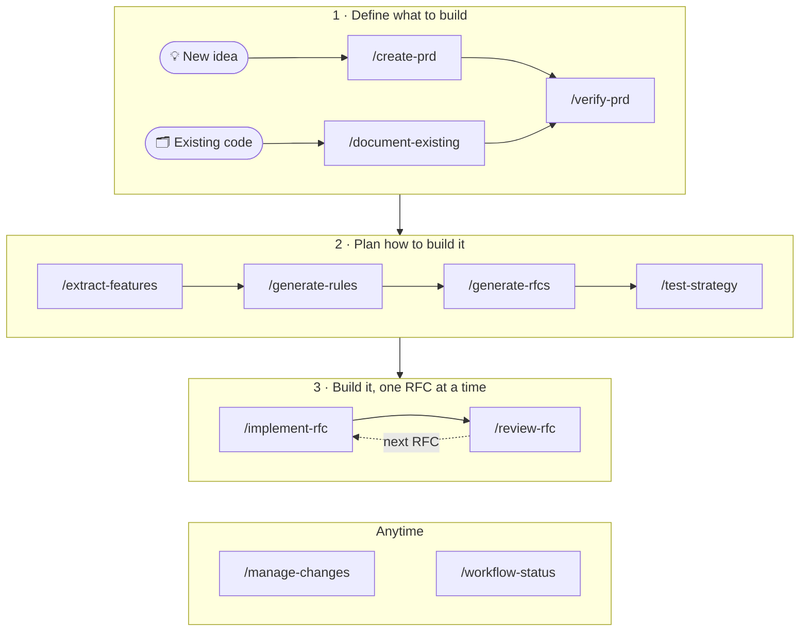

<div align="center">

<a href="https://nurettincoban.github.io/ai-prd-workflow/"></a>

# 📋 AI PRD Workflow

**Idea or existing code → verified PRD → features → rules → sequenced RFCs → reviewed, tested code**

[](https://github.com/nurettincoban/ai-prd-workflow/actions/workflows/ci.yml)
[](LICENSE)
[](https://github.com/nurettincoban/ai-prd-workflow/stargazers)
[](#quick-start)
[](#install-options)

**[🌐 Website](https://nurettincoban.github.io/ai-prd-workflow/)** · **[See a real run](#what-one-run-produced)** · **[Quick start](#quick-start)** · **[How it works](#how-it-works)** · **[Why](#why-this-workflow)** · **[Evidence](#evidence)** · **[Install options](#install-options)**

English · [简体中文](README.zh-CN.md) · [Türkçe](README.tr.md) · [日本語](README.ja.md) · [한국어](README.ko.md) · [Español](README.es.md)

</div>

---

AI coding agents write code well. They are worse at deciding what to build, remembering yesterday's decisions, and noticing when two documents disagree. This workflow handles that part. It takes an idea — or a codebase that already exists — to a reviewed product spec (PRD), prioritized features, project rules, and small implementation specs (RFCs) in dependency order. Then it implements and reviews them one at a time.

Every step writes a markdown file that the next step reads, so decisions outlive the chat session. A script checks that the files still agree with each other. No CLI to learn, no framework to adopt, no lock-in: the commands are plain prompts, installed as skills for Claude Code, Codex, Copilot, Cursor, Gemini CLI, OpenCode and Devin.

## What one run produced

We took the spec of a small URL shortener that our own v2.0 prompts had produced. It looks finished. We ran the commands on it, and three of the things they caught before any code existed were:

| What was there | What the workflow did |
|---|---|
| "Redirect short URL to original URL via HTTP 301" | `/verify-prd`: browsers cache a 301, so repeat clicks are never counted and deleted links keep redirecting. The fixed spec redirects with 302, and [RFC-003](examples/url-shortener/after/RFCs/RFC-003-Redirect-and-Click-Recording.md) tests "never 301". |
| No user accounts, and anyone can "delete a short URL" | `/verify-prd`: anyone can delete anyone's link. Nobody was there to decide, so it wrote a proposed fix as an open question marked **(assumption)**, not as a decision. |
| [RFC-002](examples/url-shortener/before/RFCs/RFC-002-Click-Analytics.md) claims features F5, F6 and F11 | `/workflow-status`: its acceptance criteria only test the API, so the analytics page and chart those features require had nothing to make anyone build them. Every ID was cited, so a script could not see it. |

**10 of 10** problems we had listed by hand, found by `/verify-prd` without seeing the list. (A plain agent asked to review the same PRD found them too: [eval results](evals/README.md#results).) **11 of 13** cross-document problems, found by the current `/workflow-status` in each of three runs, graded blind. The 3.1.0 prompt found 8, 9 and 8, and the new checks were written against what it missed on this same plan, so [read that as a regression check](examples/url-shortener/workflow-status-reruns/GRADING.md), not a held-out score. **12 RFCs** and **203 planned tests**, generated by the 3.1.0 commands, each RFC read cold by a second model, with the readers started by hand. About an hour of agent time on Claude Opus 5.5, and nobody answered the commands' questions. **[Browse the whole run →](examples/url-shortener/)**

## Quick start

In Claude Code, install the plugin:

```
/plugin marketplace add nurettincoban/ai-prd-workflow
/plugin install prd-workflow@ai-prd-workflow
```

> [!IMPORTANT]
> Restart Claude Code now. A running session does not see new skills, so the first command fails with `Unknown skill` — which looks like a broken install but is only a stale session.

Then start the interview. It takes about ten minutes, and `/verify-prd` tells you within a few more whether this is for you:

```
/prd-workflow:create-prd
/prd-workflow:verify-prd
```

<details>
<summary><b>Codex, GitHub Copilot, Cursor, Gemini CLI, OpenCode, Devin, or any chat assistant</b></summary>

Install the skills into your project:

```bash
cd your-project
curl -fsSL https://raw.githubusercontent.com/nurettincoban/ai-prd-workflow/main/install.sh | bash -s -- .
```

Restart your tool after installing, for the same reason. In Codex, type `$create-prd` instead of `/create-prd`. In a chat assistant (ChatGPT, Claude.ai, …), copy a prompt from the [command table](#how-it-works) and paste it in.

</details>

The full sequence, shown with the short names that `install.sh` gives the commands. With the plugin, each one carries the prefix: `/prd-workflow:extract-features`.

```
/create-prd          # interview → PRD.md   (existing code? use /document-existing instead)
/verify-prd          # gaps and contradictions → improved PRD.md + PRD-REVIEW.md
/extract-features    # → FEATURES.md
/generate-rules      # → RULES.md
/generate-rfcs       # → RFCs/ + RFCS.md, in dependency order
/test-strategy       # → TEST-STRATEGY.md, before any test is written
/implement-rfc 001   # plan → your approval → code → proof that it works
/review-rfc 001      # review in a fresh context → reviews/REVIEW-RFC-001.md
```

Run `/workflow-status` whenever you are unsure what comes next, and `/manage-changes` when requirements change.

**Not every project needs every step.** The interview records the project's size, and the commands that write documents are told to scale to it: about ten rules and one to three RFCs for a weekend tool. No example shows that yet: the todo-cli run's rules and RFCs were written before this change, and it shows what happens without it (56 rules for 478 lines). To add one feature to a codebase you already have, run `/document-existing` once, then `/manage-changes` for the feature, `/generate-rfcs` (it extends the existing plan) and `/implement-rfc`. `/test-strategy` is optional when the RFC's criteria already say how to test them.

**Or try it on the example.** The `before/` folder looks complete, and it is not. Copy it, so the original stays for comparison:

```bash
git clone https://github.com/nurettincoban/ai-prd-workflow.git
cp -r ai-prd-workflow/examples/url-shortener/before linksnip
ai-prd-workflow/install.sh linksnip
```

Open `linksnip` in your AI tool, run `/workflow-status` or `/verify-prd` (`install.sh` installs project skills, so there is no prefix), and compare the result with [the problems we found by hand](examples/url-shortener/README.md) and with what [our run](examples/url-shortener/after/) produced.

## How it works



| Command | What it does | Writes | Prompt |
|---|---|---|---|
| `/create-prd` | Interviews you about the idea, a few questions at a time | `PRD.md` | [view](interactive-prd-creation-prompt.md) |
| `/document-existing` | Reads an existing codebase, then asks what the code cannot tell it | `PRD.md`, `FEATURES.md`, `RULES.md` | [view](document-existing-prompt.md) |
| `/verify-prd` | Finds gaps, contradictions, and claims that cannot be built as written | `PRD.md`, `PRD-REVIEW.md` | [view](prd-comprehensive-verification-prompt.md) |
| `/extract-features` | Turns requirements into features with permanent IDs and MoSCoW priorities | `FEATURES.md` | [view](prd-to-features-prompt.md) |
| `/generate-rules` | Sets the standards the agent must follow, with dependency versions checked against the registry | `RULES.md` | [view](prd-to-rules-prompt.md) |
| `/generate-rfcs` | Splits the work into small RFCs in dependency order, then checks each one for gaps with a fresh reader | `RFCs/`, `RFCS.md` | [view](prd-to-rfcs-prompt.md) |
| `/test-strategy` | Plans the tests for each RFC before they are written | `TEST-STRATEGY.md` | [view](testing-strategy-prompt.md) |
| `/implement-rfc <id>` | Plans, waits for your approval, writes the code, then runs the build and tests to prove each criterion | code, RFC status | [view](implementation-prompt-template.md) |
| `/review-rfc <id>` | Reviews the code against the RFC, the rules, and the test plan, in a fresh context | `reviews/` | [view](code-review-prompt.md) |
| `/manage-changes` | Checks a change against past decisions and rules, then updates every affected file together | `changes/` | [view](prd-change-management-prompt.md) |
| `/workflow-status` | Reports what is done, what has drifted, and what to do next | — | [view](workflow-status-prompt.md) |

A few rules hold it together:

- **Plan, approve, then code.** `/implement-rfc` stops after the plan and waits for you.
- **Review with fresh eyes.** `/review-rfc` will not review code written in the same conversation. In Claude Code it runs in a separate context automatically.
- **IDs never change.** Requirements, features, rules, and RFCs cite each other by ID. [`scripts/trace-check.py`](scripts/trace-check.py) fails when a citation breaks or a Must-have feature has no RFC, and the commands run it for you.
- **When files disagree,** `PRD.md` wins over `FEATURES.md`, which wins over `RULES.md`, then the RFCs. The commands say which file they followed, and flag the other for correction.

## Why this workflow

Your coding agent probably has a plan mode. A plan mode plans one task. This workflow plans the product:

| Built-in plan mode | This workflow |
|---|---|
| Plans one task: "how do I build this?" | Plans the product: what are we building, for whom, and what is out of scope? |
| The plan disappears with the session | PRD, features, rules, and RFCs stay — across sessions, models, tools, and teammates |
| Takes your request at face value | Interviews you first, so decisions are written down before any code exists |
| Reviews code by "looks right" | Reviews against written acceptance criteria, and checks the files against each other |

The two work together: `/generate-rfcs` decides what the next piece of work is, and `/implement-rfc` hands your agent's planner a small, well-defined task.

**Use it for** multi-week builds, and anything real you build with AI, where scope creep and forgotten decisions hurt more than code quality. **Skip it for** a one-line fix.

If you know spec-driven development (GitHub Spec Kit, Amazon Kiro), this is the same idea, with RFCs as the unit of work, no CLI or framework to adopt, and a script that checks the documents against each other. It has been RFC-driven since [March 2025](https://github.com/nurettincoban/ai-prd-workflow/commit/0993e28).

## Evidence

Everything in this section that you can check, you can check here:

- **[The url-shortener example](examples/url-shortener/)** — the v2.0 spec, the problems we found in it by hand, and a full run of the 3.1.0 commands on it (the prompts have changed since; the example says how). Fresh-context runs that never saw our list found 10 of 10 PRD problems (`/verify-prd`) and 11 of 13 cross-document problems in three of three `/workflow-status` runs, plus several we had missed. Cold reads by a second model, run by hand in this example, found over 150 places where the generated RFCs would have made an implementer guess; the [reports](examples/url-shortener/cold-reads/) are there too. Apart from the three `/workflow-status` runs, these are single runs of one model.
- **[The todo-cli example](examples/todo-cli/)** — a ten-line idea for a terminal to-do list, taken all the way to reviewed code and 91 passing tests, every step on Claude Sonnet 5.5 with nobody answering questions. It shows what the reviews sent back and why, the one decision the run made on the user's behalf, and an outside critic's bug report taken through `/manage-changes`: the bugs went back to their RFCs, and the four changes to what `td` should do wait for the user.
- **[The eval suite](evals/)** — runs the same checks with and without the workflow, on your own account, so you can measure the difference yourself. It grades the ten PRD problems and seven of the thirteen cross-document ones, the ones a regular expression can recognize reliably. [Our run](evals/README.md#results) found no difference on the PRD review or on keeping IDs, because a plain agent did as well. It found a small one on the cross-document check, 0.81 against 0.71 over three runs each.

<p align="center">
  
</p>
<p align="center"><sub>A real <code>/workflow-status</code> run on the v2.0 example, condensed. <a href="examples/url-shortener/workflow-status-on-before.md">Full report</a></sub></p>

Each step looks at the project from a different angle, and each catches problems the others cannot. We saw this while building a TypeScript library end to end with the workflow. That library is not public, so treat this table as a field report, not proof:

| Step | What it caught | Why only this step caught it |
|---|---|---|
| `/verify-prd` | A function contradicting the PRD's own convention; an unspecified color space; a hidden rendering dependency | It compared the spec with the reference implementation |
| RFC edge cases | That the pinned TypeScript version would break the build; a clone-aliasing bug | It reasoned about code that did not exist yet |
| `/review-rfc` | A geometry leak on an error path; unvalidated `NaN` inputs | All 17 acceptance criteria had already passed |
| `/test-strategy` | Normals never checked for being finite, so degenerate geometry rendered black while every test passed | It asks which tests should exist, not which do |
| `/workflow-status` | Two required files never created, while their RFC was reported complete | It checked claims against the files on disk |
| CI from an RFC | A wrong peer-dependency range: the tests failed on three published versions | It ran the tests against each version |
| Fresh-reader check | An RFC that contradicted itself; a criterion that could only pass by luck | The author had read past both, repeatedly |

The most striking result: before any code existed, an RFC's edge-case section predicted that a build plugin would not support TypeScript 7 yet, and named the fallback version. That is exactly what happened. Type-checking passed throughout, so only running the build revealed it.

IDs held, too. When the PRD changed mid-project, a fresh agent re-ran `/extract-features` and added the new features at the end instead of renumbering — without being told to, because the RFCs cite features by number.

## Install options

`install.sh` puts the skills where each tool looks for them:

| Tool | Folder | Run a command |
|---|---|---|
| Claude Code | `.claude/skills/`, or the plugin | `/create-prd` (plugin: `/prd-workflow:create-prd`) |
| GitHub Copilot (VS Code, CLI) | `.agents/skills/` | `/create-prd` |
| Cursor | `.agents/skills/` | `/create-prd`, from the `/` menu |
| Gemini CLI | `.agents/skills/` | `/create-prd` |
| OpenCode | `.agents/skills/` | `/create-prd` |
| Devin | `.agents/skills/` | `/create-prd` |
| Codex | `.agents/skills/` | `$create-prd`, or pick it from `/skills` |

From a clone of this repository:

```bash
./install.sh /path/to/your/project            # both folders (the default)
./install.sh /path/to/your/project --claude   # Claude Code only
./install.sh /path/to/your/project --agents   # the other tools only
```

- `install.sh` never overwrites a skill you have edited. `--force` replaces it after saving a backup.
- `--ref <tag>` installs a specific [tagged release](https://github.com/nurettincoban/ai-prd-workflow/tags); in the curl line, replace `main` with the same tag: `…/ai-prd-workflow/<tag>/install.sh | bash -s -- . --ref <tag>`.
- Upgrading from v2? Add `--remove-legacy` to move the old command files into a backup folder.
- Needs `bash`, and `python3` for the traceability check. The commands write `PRD.md`, `FEATURES.md`, `RULES.md`, `RFCS.md`, `RFCs/` and `reviews/` in the project root; commit them with your code. To uninstall, delete the skill folders `install.sh` created.
- Prefer copy-paste? `./copy-prompt.sh --list` shows the prompts, and `./copy-prompt.sh <file>` copies one to your clipboard.

## Tips

- **Answer the questions.** The interview commands work best with your real decisions, not the agent's guesses.
- **Read each file before you move on.** Fixing a PRD takes minutes; fixing code built on a wrong PRD takes days.
- **Keep the rules in context.** Reference `RULES.md` from your agent config (`CLAUDE.md`, `AGENTS.md`, or `.cursor/rules/`). `/generate-rules` suggests how.
- **Parallelize if you can.** An RFC can start as soon as its declared predecessors are done. Working alone, just follow the numbers.

## Contributing

See [CONTRIBUTING.md](CONTRIBUTING.md). The prompt files at the root are the source; everything else is generated or checked from them.

## Acknowledgments

Thank you to [Anthropic](https://www.anthropic.com) for supporting this project and welcoming it into its open source program.

## License

MIT — see [LICENSE](LICENSE).

---

<p align="center">If this workflow saved you from building the wrong thing, a ⭐ helps others find it.</p>
