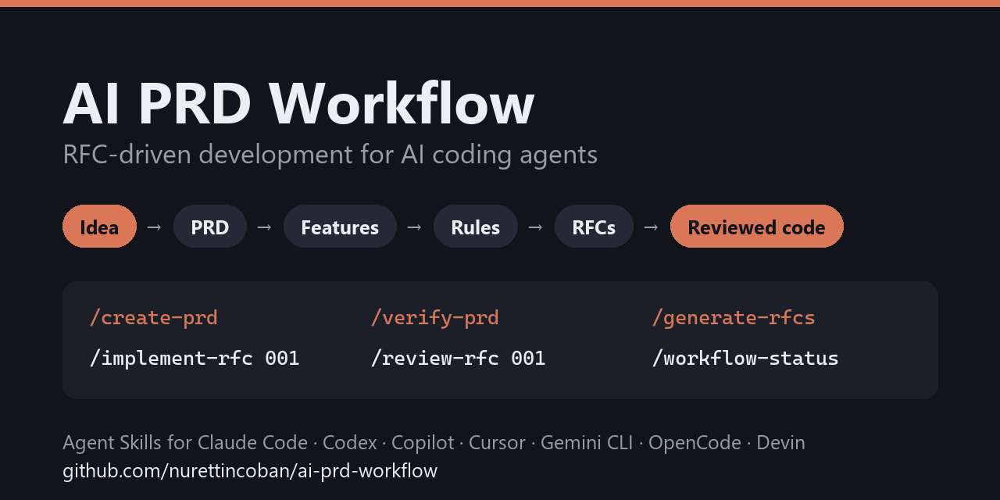
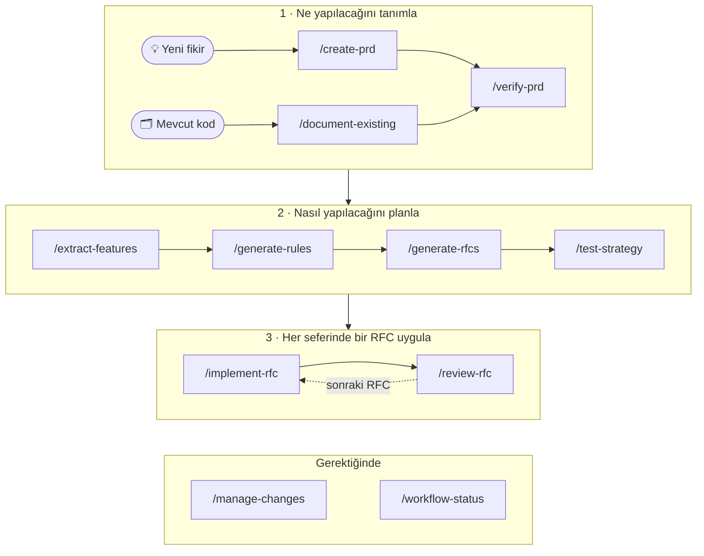

<div align="center">

<a href="https://nurettincoban.github.io/ai-prd-workflow/"></a>

# 📋 AI PRD Workflow

**Fikir veya mevcut kod → doğrulanmış PRD → özellikler → kurallar → sıralı RFC'ler → incelenmiş, test edilmiş kod**

[](https://github.com/nurettincoban/ai-prd-workflow/actions/workflows/ci.yml)
[](LICENSE)
[](https://github.com/nurettincoban/ai-prd-workflow/stargazers)
[](#hızlı-başlangıç)
[](#kurulum-seçenekleri)

**[🌐 Web sitesi](https://nurettincoban.github.io/ai-prd-workflow/)** · **[Gerçek bir çalıştırmayı görün](#bir-çalıştırmanın-ürettikleri)** · **[Hızlı başlangıç](#hızlı-başlangıç)** · **[Nasıl çalışır](#nasıl-çalışır)** · **[Neden](#neden-bu-iş-akışı)** · **[Kanıtlar](#kanıtlar)** · **[Kurulum seçenekleri](#kurulum-seçenekleri)**

[English](README.md) · [简体中文](README.zh-CN.md) · Türkçe · [日本語](README.ja.md) · [한국어](README.ko.md) · [Español](README.es.md)

</div>

> [!NOTE]
> Bu çeviri İngilizce README'nin gerisinde kalabilir; bir fark varsa [İngilizce sürüm](README.md) geçerlidir.

---

AI kodlama ajanları kod yazmakta iyidir. Ne yapılacağına karar vermekte, dünkü kararları hatırlamakta ve iki dokümanın birbiriyle çeliştiğini fark etmekte o kadar iyi değildirler. Bu iş akışı tam olarak bu kısmı üstlenir: bir fikri — ya da zaten var olan bir kod tabanını — gözden geçirilmiş bir ürün spesifikasyonuna (PRD), önceliklendirilmiş özelliklere, proje kurallarına ve bağımlılık sırasına dizilmiş küçük uygulama spesifikasyonlarına (RFC'ler) dönüştürür. Ardından bunları teker teker uygular ve inceler.

Her adım, bir sonraki adımın okuyacağı bir markdown dosyası yazar; böylece kararlar sohbet oturumu kapandığında kaybolmaz. Bir betik de bu dosyaların hâlâ birbiriyle tutarlı olduğunu kontrol eder. Öğrenilecek bir CLI, benimsenecek bir framework, bağımlı kalınacak bir araç yok: komutlar düz prompt'lardır ve Claude Code, Codex, Copilot, Cursor, Gemini CLI, OpenCode ve Devin için skill olarak kurulur.

## Bir çalıştırmanın ürettikleri

Kendi v2.0 prompt'larımızın ürettiği küçük bir URL kısaltıcının spesifikasyonunu aldık. Bitmiş görünüyor. Komutları onun üzerinde çalıştırdık; daha hiç kod yokken yakaladıklarından üçü şunlar:

| Orada ne vardı | İş akışının yaptığı |
|---|---|
| "Kısa URL'yi HTTP 301 ile orijinal URL'ye yönlendir" | `/verify-prd`: tarayıcılar 301'i önbelleğe alır; bu yüzden tekrarlanan tıklamalar hiç sayılmaz ve silinen bağlantılar yönlendirmeye devam eder. Düzeltilmiş spesifikasyon 302 ile yönlendirir ve [RFC-003](examples/url-shortener/after/RFCs/RFC-003-Redirect-and-Click-Recording.md) "asla 301 değil" diye test eder. |
| Kullanıcı hesabı yok ve herkes "kısa bir URL'yi silebilir" | `/verify-prd`: herkes herkesin bağlantısını silebilir. Karar verecek kimse yoktu; bu yüzden önerdiği çözümü bir karar olarak değil, **(assumption)** (varsayım) işaretli açık bir soru olarak yazdı. |
| [RFC-002](examples/url-shortener/before/RFCs/RFC-002-Click-Analytics.md), F5, F6 ve F11 özelliklerini karşıladığını iddia ediyor | `/workflow-status`: kabul kriterleri yalnızca API'yi test ediyor; bu yüzden o özelliklerin gerektirdiği analiz sayfasını ve grafiği kimseye yaptıracak hiçbir şey yoktu. Her ID'ye atıf yapılmıştı, bu yüzden bir betik bunu göremezdi. |

Elle listelediğimiz **10 problemin 10'u**, listeyi hiç görmeyen `/verify-prd` tarafından bulundu. (Aynı PRD'yi incelemesi istenen sade bir ajan da bunları buldu: [değerlendirme sonuçları](evals/README.md#results).) Dokümanlar arası **13 problemin 11'i**, üç çalıştırmanın her birinde güncel `/workflow-status` tarafından bulundu; körlemesine puanlandı. 3.1.0 prompt'u 8, 9 ve 8 buldu; yeni kontroller onun aynı plan üzerinde kaçırdıklarına göre yazıldı, bu yüzden bunu [bir gerileme kontrolü olarak okuyun](examples/url-shortener/workflow-status-reruns/GRADING.md), bağımsız bir test skoru olarak değil. **12 RFC** ve **203 planlanmış test**, 3.1.0 komutlarıyla üretildi; her RFC ikinci bir model tarafından bağlamsız olarak (cold read) okundu, okuyucular elle başlatıldı. Claude Opus 5.5 üzerinde yaklaşık bir saatlik ajan süresi ve komutların sorularını kimse yanıtlamadı. **[Çalıştırmanın tamamına göz atın →](examples/url-shortener/)**

## Hızlı başlangıç

Claude Code'da eklentiyi kurun:

```
/plugin marketplace add nurettincoban/ai-prd-workflow
/plugin install prd-workflow@ai-prd-workflow
```

> [!IMPORTANT]
> Claude Code'u şimdi yeniden başlatın. Çalışan bir oturum yeni skill'leri görmez; ilk komut `Unknown skill` hatası verir. Bu, kurulum bozukmuş gibi görünür ama oturum yalnızca eskimiştir.

Ardından mülakatı başlatın. Yaklaşık on dakika sürer ve `/verify-prd` birkaç dakika içinde bunun size göre olup olmadığını söyler:

```
/prd-workflow:create-prd
/prd-workflow:verify-prd
```

<details>
<summary><b>Codex, GitHub Copilot, Cursor, Gemini CLI, OpenCode, Devin veya herhangi bir sohbet asistanı</b></summary>

Skill'leri projenize kurun:

```bash
cd your-project
curl -fsSL https://raw.githubusercontent.com/nurettincoban/ai-prd-workflow/main/install.sh | bash -s -- .
```

Aynı nedenle kurulumdan sonra aracınızı yeniden başlatın. Codex'te `/create-prd` yerine `$create-prd` yazın. Bir sohbet asistanında (ChatGPT, Claude.ai, …) [komut tablosundan](#nasıl-çalışır) bir prompt kopyalayıp yapıştırın.

</details>

Tam sıra, `install.sh`'nin komutlara verdiği kısa adlarla gösteriliyor. Eklentiyle her komut ön eki taşır: `/prd-workflow:extract-features`.

```
/create-prd          # mülakat → PRD.md   (kod zaten var mı? bunun yerine /document-existing)
/verify-prd          # boşluklar ve çelişkiler → iyileştirilmiş PRD.md + PRD-REVIEW.md
/extract-features    # → FEATURES.md
/generate-rules      # → RULES.md
/generate-rfcs       # → RFCs/ + RFCS.md, bağımlılık sırasıyla
/test-strategy       # → TEST-STRATEGY.md, daha hiçbir test yazılmadan
/implement-rfc 001   # plan → onayınız → kod → çalıştığının kanıtı
/review-rfc 001      # temiz bir bağlamda inceleme → reviews/REVIEW-RFC-001.md
```

Sıradaki adımdan emin olmadığınızda `/workflow-status`, gereksinimler değiştiğinde `/manage-changes` çalıştırın.

**Her projenin her adıma ihtiyacı yok.** Mülakat projenin boyutunu kaydeder ve doküman yazan komutlara buna göre ölçeklenmeleri söylenir: bir hafta sonu aracı için yaklaşık on kural ve bir ila üç RFC. Bunu gösteren bir örnek henüz yok: todo-cli çalıştırmasının kuralları ve RFC'leri bu değişiklikten önce yazıldı ve o olmadan ne olduğunu gösteriyor (478 satır için 56 kural). Elinizdeki bir kod tabanına tek bir özellik eklemek için `/document-existing`'i bir kez çalıştırın, ardından özellik için `/manage-changes`, `/generate-rfcs` (mevcut planı genişletir) ve `/implement-rfc` çalıştırın. RFC'nin kriterleri nasıl test edileceklerini zaten söylüyorsa `/test-strategy` isteğe bağlıdır.

**Ya da örnek üzerinde deneyin.** `before/` klasörü eksiksiz görünüyor, ama değil. Orijinali karşılaştırma için kalsın diye onu kopyalayın:

```bash
git clone https://github.com/nurettincoban/ai-prd-workflow.git
cp -r ai-prd-workflow/examples/url-shortener/before linksnip
ai-prd-workflow/install.sh linksnip
```

`linksnip` klasörünü AI aracınızda açın, `/workflow-status` veya `/verify-prd` çalıştırın (`install.sh` proje skill'leri kurar, bu yüzden ön ek yoktur) ve sonucu [elle bulduğumuz problemlerle](examples/url-shortener/README.md) ve [bizim çalıştırmamızın](examples/url-shortener/after/) ürettikleriyle karşılaştırın.

## Nasıl çalışır



| Komut | Ne yapar | Yazdığı | Prompt |
|---|---|---|---|
| `/create-prd` | Fikriniz hakkında, her seferinde birkaç soruyla mülakat yapar | `PRD.md` | [görüntüle](interactive-prd-creation-prompt.md) |
| `/document-existing` | Mevcut bir kod tabanını okur, ardından kodun söyleyemediklerini sorar | `PRD.md`, `FEATURES.md`, `RULES.md` | [görüntüle](document-existing-prompt.md) |
| `/verify-prd` | Boşlukları, çelişkileri ve yazıldığı haliyle hayata geçirilemeyecek gereksinimleri bulur | `PRD.md`, `PRD-REVIEW.md` | [görüntüle](prd-comprehensive-verification-prompt.md) |
| `/extract-features` | Gereksinimleri kalıcı ID'li ve MoSCoW öncelikli özelliklere dönüştürür | `FEATURES.md` | [görüntüle](prd-to-features-prompt.md) |
| `/generate-rules` | Ajanın uyması gereken standartları belirler; bağımlılık sürümlerini paket kayıt sisteminden doğrular | `RULES.md` | [görüntüle](prd-to-rules-prompt.md) |
| `/generate-rfcs` | İşi bağımlılık sırasına göre küçük RFC'lere böler, ardından her birini "taze bir okuyucuya" eksikler için kontrol ettirir | `RFCs/`, `RFCS.md` | [görüntüle](prd-to-rfcs-prompt.md) |
| `/test-strategy` | Testler yazılmadan önce her RFC'nin testlerini planlar | `TEST-STRATEGY.md` | [görüntüle](testing-strategy-prompt.md) |
| `/implement-rfc <id>` | Plan yapar, onayınızı bekler, kodu yazar, sonra her kabul kriterini kanıtlamak için derlemeyi ve testleri çalıştırır | kod, RFC durumu | [görüntüle](implementation-prompt-template.md) |
| `/review-rfc <id>` | Kodu temiz bir bağlamda RFC'ye, kurallara ve test planına göre inceler | `reviews/` | [görüntüle](code-review-prompt.md) |
| `/manage-changes` | Bir değişikliği geçmiş kararlara ve kurallara göre kontrol eder, sonra etkilenen bütün dosyaları birlikte günceller | `changes/` | [görüntüle](prd-change-management-prompt.md) |
| `/workflow-status` | Nelerin bittiğini, nelerin saptığını ve sırada ne olduğunu raporlar | — | [görüntüle](workflow-status-prompt.md) |

İş akışını bir arada tutan birkaç kural:

- **Planla, onayla, sonra kodla.** `/implement-rfc` planı sunduktan sonra durur ve sizi bekler.
- **Taze gözle incele.** `/review-rfc`, aynı sohbette yazılmış kodu incelemez; Claude Code'da otomatik olarak ayrı bir bağlamda çalışır.
- **ID'ler asla değişmez.** Gereksinimler, özellikler, kurallar ve RFC'ler birbirine ID ile atıf yapar. Bir atıf koptuğunda ya da bir Must-have özelliğin RFC'si olmadığında [`scripts/trace-check.py`](scripts/trace-check.py) hata verir; komutlar onu sizin yerinize çalıştırır.
- **Dosyalar çeliştiğinde** `PRD.md`, `FEATURES.md`'nin; o `RULES.md`'nin; o da RFC'lerin önüne geçer. Komutlar hangi dosyayı esas aldığını söyler ve diğerini düzeltilmek üzere işaretler.

## Neden bu iş akışı

Kodlama ajanınızın muhtemelen bir plan modu var. Plan modu tek bir görevi planlar; bu iş akışı ise ürünü planlar:

| Yerleşik plan modu | Bu iş akışı |
|---|---|
| Tek bir görevi planlar: "bunu nasıl yaparım?" | Ürünü planlar: ne yapıyoruz, kimin için ve neler kapsam dışında? |
| Plan, oturumla birlikte kaybolur | PRD, özellikler, kurallar ve RFC'ler kalır — oturumlar, modeller, araçlar ve ekip arkadaşları arasında |
| İsteğinizi olduğu gibi kabul eder | Önce sizinle mülakat yapar; kararlar daha hiç kod yazılmadan kayda geçer |
| Kodu "doğru görünüyor"a göre inceler | Yazılı kabul kriterlerine göre inceler ve dosyaları birbiriyle karşılaştırır |

İkisi birlikte çalışır: `/generate-rfcs` sıradaki işin ne olduğuna karar verir, `/implement-rfc` ise ajanınızın planlayıcısına küçük ve net tanımlanmış bir görev verir.

**Şunlar için kullanın:** haftalar süren projeler ve AI ile ciddi olarak geliştirdiğiniz her şey — kapsam kaymasının ve unutulan kararların kod kalitesinden daha çok zarar verdiği işler. **Şunda gerek yok:** tek satırlık bir düzeltme.

Spesifikasyon odaklı geliştirmeyi (spec-driven development; GitHub Spec Kit, Amazon Kiro) biliyorsanız, bu da aynı fikir: iş birimi olarak RFC'ler var, benimsenecek bir CLI ya da framework yok ve dokümanları birbiriyle karşılaştıran bir betik var. [Mart 2025](https://github.com/nurettincoban/ai-prd-workflow/commit/0993e28)'ten beri RFC odaklı.

## Kanıtlar

Bu bölümde doğrulanabilecek her şeyi burada doğrulayabilirsiniz:

- **[url-shortener örneği](examples/url-shortener/)** — v2.0 spesifikasyonu, içinde elle bulduğumuz problemler ve 3.1.0 komutlarının onun üzerinde tam bir çalıştırması (prompt'lar o zamandan beri değişti; örnek nasıl değiştiğini anlatıyor). Listemizi hiç görmeden temiz bir bağlamda çalışan komutlar PRD'deki 10 problemin 10'unu (`/verify-prd`) ve dokümanlar arası 13 problemin 11'ini, üç `/workflow-status` çalıştırmasının üçünde de buldu; üstüne bizim kaçırdığımız birkaç problemi de. Bu örnekte elle çalıştırılan, ikinci bir modelin bağlamsız okumaları, üretilen RFC'lerin uygulayıcıyı tahmin yürütmeye zorlayacağı 150'den fazla yer buldu; [raporlar](examples/url-shortener/cold-reads/) da orada. Üç `/workflow-status` çalıştırması dışında, bunlar tek bir modelin tekil çalıştırmalarıdır.
- **[todo-cli örneği](examples/todo-cli/)** — terminal için bir yapılacaklar listesinin on satırlık fikri, incelenmiş koda ve geçen 91 teste kadar götürüldü. Her adım Claude Sonnet 5.5 ile çalıştı ve soruları yanıtlayan kimse yoktu. İncelemelerin neyi geri gönderdiğini ve nedenini, çalıştırmanın kullanıcı adına verdiği tek kararı ve dışarıdan bir eleştirmenin hata raporunun `/manage-changes` üzerinden geçişini gösterir: hatalar kendi RFC'lerine geri gitti, `td`'nin ne yapması gerektiğine dair dört değişiklik ise kullanıcıyı bekliyor.
- **[Değerlendirme seti](evals/)** — aynı kontrolleri iş akışıyla ve iş akışı olmadan, kendi hesabınızda çalıştırır; böylece farkı kendiniz ölçebilirsiniz. On PRD problemini ve dokümanlar arası on üç problemin yedisini, yani bir düzenli ifadenin güvenilir biçimde tanıyabildiklerini puanlar. [Bizim çalıştırmamız](evals/README.md#results) PRD incelemesinde ve ID'leri korumada fark bulmadı, çünkü sade bir ajan da aynı başarıyı gösterdi. Dokümanlar arası kontrolde küçük bir fark buldu: her biri üç çalıştırmada 0,81'e karşı 0,71.

<p align="center">
  
</p>
<p align="center"><sub>v2.0 örneği üzerinde gerçek bir <code>/workflow-status</code> çalıştırmasının kısaltılmış tekrarı. <a href="examples/url-shortener/workflow-status-on-before.md">Tam rapor</a></sub></p>

Her adım projeye farklı bir açıdan bakar ve her biri diğerlerinin yakalayamadığı problemleri yakalar. Bunu, iş akışıyla uçtan uca bir TypeScript kütüphanesi geliştirirken gördük. O kütüphane herkese açık değil; bu yüzden bu tabloyu bir kanıt olarak değil, sahadan bir rapor olarak görün:

| Adım | Neyi yakaladı | Neden yalnızca bu adım yakaladı |
|---|---|---|
| `/verify-prd` | PRD'nin kendi kuralıyla çelişen bir fonksiyon; belirtilmemiş bir renk uzayı; gizli bir render bağımlılığı | Spesifikasyonu referans uygulamayla karşılaştırdı |
| RFC uç durumları | Sabitlenen TypeScript sürümünün derlemeyi bozacağı; bir klon aliasing hatası | Henüz var olmayan kod üzerine akıl yürüttü |
| `/review-rfc` | Bir hata yolunda geometri sızıntısı; doğrulanmamış `NaN` girdileri | 17 kabul kriterinin hepsi zaten geçmişti |
| `/test-strategy` | Normallerin sonlu olup olmadığı hiç kontrol edilmemişti; dejenere geometri siyah görünüyordu, oysa bütün testler geçiyordu | Hangi testlerin olması gerektiğini sorar, hangilerinin olduğunu değil |
| `/workflow-status` | RFC'si tamamlandı diye raporlanırken hiç oluşturulmamış iki zorunlu dosya | İddiaları diskteki dosyalarla karşılaştırdı |
| Bir RFC'den gelen CI | Yanlış bir peer bağımlılık aralığı: testler yayımlanmış üç sürümde başarısız oldu | Testleri her sürümde ayrı ayrı çalıştırdı |
| Taze okuyucu kontrolü | Kendisiyle çelişen bir RFC; ancak şans eseri geçebilecek bir kabul kriteri | Yazar ikisini de defalarca okuyup gözden kaçırmıştı |

En çarpıcı sonuç: henüz hiç kod yokken bir RFC'nin uç durumlar bölümü, bir derleme eklentisinin TypeScript 7'yi henüz desteklemeyeceğini öngördü ve geri dönülecek sürümü yazdı. Tam olarak bu oldu. Tip denetimi baştan sona geçti; sorunu yalnızca derlemeyi gerçekten çalıştırmak ortaya çıkardı.

ID'ler de korundu. Proje ortasında PRD değiştiğinde, taze bir ajan `/extract-features`'ı yeniden çalıştırdı ve yeni özellikleri yeniden numaralandırmak yerine sona ekledi — kimse ona söylemeden, çünkü RFC'ler özelliklere numarayla atıf yapıyordu.

## Kurulum seçenekleri

`install.sh`, skill'leri her aracın aradığı yere koyar:

| Araç | Klasör | Komut çalıştırma |
|---|---|---|
| Claude Code | `.claude/skills/` ya da eklenti | `/create-prd` (eklenti: `/prd-workflow:create-prd`) |
| GitHub Copilot (VS Code, CLI) | `.agents/skills/` | `/create-prd` |
| Cursor | `.agents/skills/` | `/create-prd`, `/` menüsünden |
| Gemini CLI | `.agents/skills/` | `/create-prd` |
| OpenCode | `.agents/skills/` | `/create-prd` |
| Devin | `.agents/skills/` | `/create-prd` |
| Codex | `.agents/skills/` | `$create-prd` ya da `/skills` içinden seçin |

Bu deponun bir klonundan:

```bash
./install.sh /path/to/your/project            # iki klasör de (varsayılan)
./install.sh /path/to/your/project --claude   # yalnızca Claude Code
./install.sh /path/to/your/project --agents   # yalnızca diğer araçlar
```

- `install.sh`, düzenlediğiniz bir skill'in üzerine asla yazmaz; `--force` önce yedek alır, sonra değiştirir.
- `--ref <tag>` belirli bir [etiketli sürümü](https://github.com/nurettincoban/ai-prd-workflow/tags) kurar; curl satırında `main` yerine aynı etiketi yazın: `…/ai-prd-workflow/<tag>/install.sh | bash -s -- . --ref <tag>`.
- v2'den mi yükseltiyorsunuz? Eski komut dosyalarını bir yedek klasörüne taşımak için `--remove-legacy` ekleyin.
- `bash` ve izlenebilirlik kontrolü için `python3` gerekir. Komutlar proje kök dizinine `PRD.md`, `FEATURES.md`, `RULES.md`, `RFCS.md`, `RFCs/` ve `reviews/` yazar; bunları kodunuzla birlikte commit edin. Kaldırmak için `install.sh`'nin oluşturduğu skill klasörlerini silin.
- Kopyala-yapıştırı mı tercih ediyorsunuz? `./copy-prompt.sh --list` prompt'ları listeler, `./copy-prompt.sh <dosya>` birini panoya kopyalar.

## Öneriler

- **Soruları yanıtlayın.** Mülakat yapan komutlar, ajanın tahminleriyle değil, sizin gerçek kararlarınızla en iyi sonucu verir.
- **İlerlemeden önce her dosyayı okuyun.** Bir PRD'yi düzeltmek dakikalar sürer; yanlış bir PRD üzerine yazılmış kodu düzeltmek günler sürer.
- **Kuralları bağlamda tutun.** Ajan yapılandırmanızdan (`CLAUDE.md`, `AGENTS.md` veya `.cursor/rules/`) `RULES.md`'ye atıf yapın; `/generate-rules` bunun nasıl yapılacağını önerir.
- **Mümkünse paralel çalışın.** Bir RFC, beyan edilen öncülleri biter bitmez başlayabilir. Tek başınıza çalışıyorsanız numaraları takip etmeniz yeterli.

## Katkıda bulunma

[CONTRIBUTING.md](CONTRIBUTING.md) dosyasına bakın. Kök dizindeki prompt dosyaları kaynaktır; geri kalan her şey onlardan üretilir ya da onlara göre kontrol edilir.

## Teşekkürler

Bu projeyi desteklediği ve açık kaynak programına kabul ettiği için [Anthropic](https://www.anthropic.com)'e teşekkür ederiz.

## Lisans

MIT — [LICENSE](LICENSE) dosyasına bakın.

---

<p align="center">Bu iş akışı sizi yanlış şeyi inşa etmekten kurtardıysa, bir ⭐ başkalarının da onu bulmasına yardımcı olur.</p>
